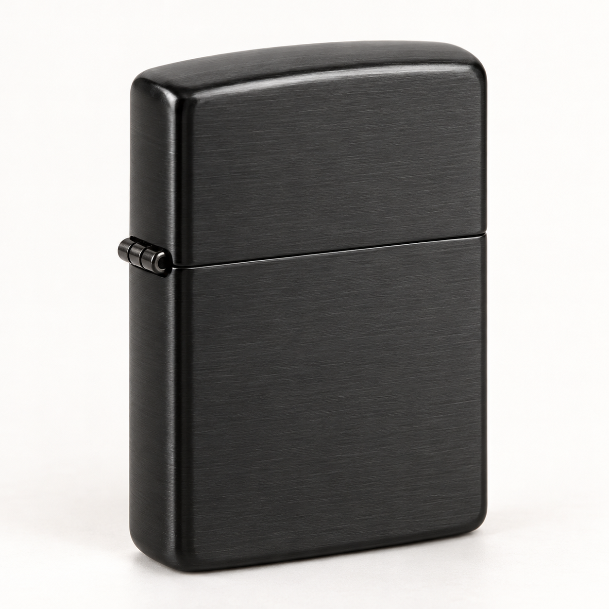

# Validación integral — 17 de octubre de 2026

## Ambiente

- Base: PostgreSQL local `rauch_erp`, clasificada como QA/pruebas.
- Aplicación: frontend `http://localhost:4200` y API `http://localhost:5299`.
- Empresa: Rauch Urban Lab; establecimiento Principal; Bodega principal.

## Datos QA

- Usuarios: Administrador QA, Facturador QA y Contador QA.
- Categoría: `QA - Pruebas automatizadas`.
- Producto: `Encendedor QA`, SKU `QA-ENC-001`.
- Factura de compra: `QA-COMPRA-20261016-001`.

Las credenciales se entregan fuera del repositorio y no se almacenan en este reporte.

## Flujo de inventario y ventas

| Operación | Cantidad | Valor unitario | Resultado |
|---|---:|---:|---|
| Inventario inicial | 30 | $5.000 | Stock 30 |
| Compra | 10 | $5.500 | Stock 40; costo promedio $5.125 |
| Venta | 2 | $8.500 | Stock 38; venta total $17.000 |

El kardex contiene `InitialStock`, `PurchaseReceipt` y `Sale`. El costo promedio permanece en $5.125 después de la venta.

## Imagen de producto

- Archivo PNG: 1.949.130 bytes.
- Carga autorizada: HTTP 200.
- Recuperación directa desde API: HTTP 200.
- Recuperación mediante proxy del frontend: HTTP 200.
- Formato GIF no permitido: rechazado con HTTP 400.
- La URL quedó asociada al producto y visible desde el catálogo.

## Permisos

| Perfil | Catálogo | Inventario | Ventas | Usuarios | Crear venta |
|---|---:|---:|---:|---:|---:|
| Administrador QA | 200 | 200 | 200 | 200 | Permitido |
| Facturador QA | 200 | 200 | 200 | 403 | Permitido |
| Contador QA | 200 | 200 | 200 | 403 | 403 |

## Automatización

- Backend: 19 pruebas aprobadas; una prueba Testcontainers omitida por requerir Docker.
- Frontend: lint correcto, una prueba unitaria aprobada y build de producción correcto.
- E2E Chromium: 4 pruebas aprobadas para login, administrador, ventas y contador.

## Defectos corregidos

- Permisos faltantes en bodegas, marcas, inventario y kardex.
- Acciones visibles para perfiles sin autorización.
- Error 500 al omitir paginación en productos, usuarios y kardex.
- Tipos de movimiento serializados como números en vez de nombres.
- Proxy Docker sin ruta `/uploads/` para imágenes de producto.

## Pendientes antes de producción

- Ejecutar la prueba Testcontainers en un agente con Docker.
- Crear manifiesto de producción con secretos y seed desactivado.
- Persistir o externalizar imágenes de producto.
- Configurar backups, monitoreo, HTTPS y recuperación ante fallos.
